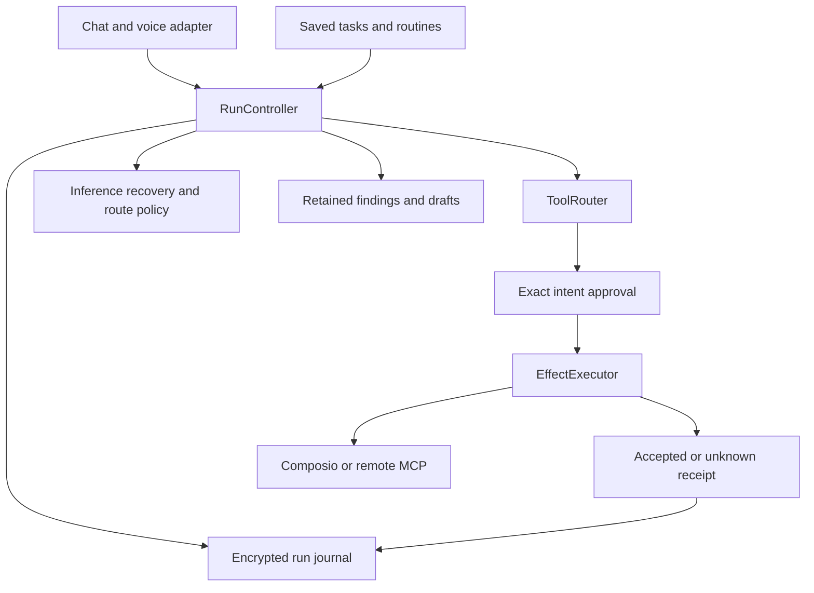

# KAI shared-runtime implementation status

Review date: 2026-11-23. Target alpha: 0.5.0 (40). Baseline Android commit: `4f30648fa4547000df5bb639ffa32631c96ce628`; gateway reference baseline: `331a449192d5dbf752df25f848df5415f0223c06`.

This is the first implementation of the architecture plan, not completion of the entire 64-item product roadmap. `IMPLEMENTATION_STATUS.csv` preserves every original acceptance criterion and records the current evidence or remaining work. “Implemented” describes the bounded code path; it does not certify a production integration, all providers, all devices or all languages.

## Native transport phase two (0.5.2)

The 0.5.0 inventory counts below remain historical. This phase adds signed, expiring per-route qualification evidence and a two-turn supplier probe; a plain allowlist no longer enables native calling. Android requires protocol-2 qualification and retains opaque provider continuation through tool exchanges, saved tasks and exact approval resumes. Envelopes are bound to the local account/model route, excluded from exports/diagnostics/retrieval, and cleared when provider wire becomes ineligible. The gateway encrypts supported private provider fields and binds them to the credit owner, model and exact assistant call before signing the response.

This closes bounded managed-route implementation gaps in KAI-010/012/014/015. It does not qualify any live route by itself. General provider replay formats, production activation, live paid-provider/connected-service tests and physical Android validation remain separate gates. See `qa/0.5.2/VALIDATION.md` for actual results and the companion gateway `deploy/koin-mainnet/NATIVE_TOOLS_PHASE2.md` for the operator rollout.

## Architecture now in code

The phone remains the state and permission authority. The inference gateway is not an agent host. Both interactive and scheduled paths enter the same bounded run driver and effect boundary. Their prompt/context assembly still lives in separate adapters; this change does not claim to have eliminated all ViewModel or saved-task domain code.

Research is persisted before an approval exists. Canonical observations outlive individual saved steps, while provider-specific call wire is cleared when routes change. An exact approved intent is submitted once; uncertainty produces reconciliation state. A model's “done” is a proposed outcome, checked against same-run effect receipts. Accepted service requests do not imply independently verified publication. Received document links are retained; invented Google Docs identifiers are suppressed.

Questions, partial outcomes, waiting approval, pause and failure are separate states. Explicit continuation authorizes another bounded allowance; worker retries do not replenish it. Stop speaking stops playback, while Pause stops the selected execution. Waiting-input answers retain the original goal. The interrupted user's already heard history remains subject to the existing playback-cursor protections.

## Scope and unfinished work

Status counts: {"implemented": 23, "partial": 27, "gated": 1, "planned": 13}. These are inventory counts, not percentage completion or proof that a whole acceptance criterion passed.

The largest unfinished prerequisites are provider-private replay envelopes, live route qualification/native gateway rollout, a priced credit/deadline ledger, claim-level source assurance, generic read-back verification, independent-read concurrency, a complete typed voice reducer, and modern physical Android lifecycle validation. These must precede a production-ready claim.

The broader product work remains explicit: portable skills/SDK and revocation manifests; paired code/browser hosts; isolated delegation; cross-device ownership; marketplace/rentals; optional OAuth onboarding; channel adapters; bounded permission grants; and a full visual workflow canvas. None is implied by adding MCP or a workflow JSON editor.

## Database and compatibility

SQLCipher schema 3 moves execution runs, saved runs, action records and imported documents from the core JSON row to ordered encrypted component rows. Conversations and memory already used separate rows. Changed records are rewritten in the same transaction as the core revision; unchanged large records are not serialized by speech-progress updates. A combined 32 MiB payload guard fails the transaction without truncation. SQLCipher encryption, secure deletion, full synchronous transactions, Keystore wrapping and unreadable-data preservation remain in force.

The schema 2 upgrade copies all component rows, clears the old component arrays and advances the database version atomically. Failure rolls back. A pre-update backup is useful for deliberate downgrade: schema 2 binaries must fail closed on schema 3 and cannot read it. No destructive fallback or automatic legacy restoration is added. Legacy intent fingerprints stay identical when new optional transport/run fields have default values. Temporary conversations do not persist runtime records and cannot create external action ledgers; connected actions require a saved conversation.

At 500 retained runs, only completed plain-answer chat runtime records with no findings, drafts or effect evidence are eligible for retirement; conversation messages remain. Important work is not silently discarded. If all retained records are important, the user must remove old conversations before adding more.

## Connection and model boundaries

Tools are discovered and inspected on demand. Both transports pin schema, owner, account and generation. MCP annotations do not grant read-only trust: all MCP execution requires exact approval. Endpoint/token changes revoke unsubmitted approval. Public HTTPS and fixed-origin transport checks are enforced. Supported schemas intentionally reject unsupported composition/reference constructs rather than guessing.

Remote MCP supports bounded Streamable HTTP JSON/SSE for the implemented protocol profiles. It does not claim full MCP compliance, OAuth, local stdio, roots, sampling, durable MRTR resumption or automatic input-required replay. A server requiring these features must fail explicitly. Saved credentials remain encrypted and are omitted from normal workspace export. Imported workflow capability declarations never grant real accounts or authority.

Fallback is user configured, ordered and restricted to the same account, endpoint, wallet and free/paid policy. A long Retry-After pauses; it is not an invitation to bypass provider limits with another model. Output allowances are visible to the user. No automatic output-spend increase is enabled for the managed credit account. The gateway change only classifies empty length endings as reasoning-only/output-exhausted; it does not perform another paid POST or activate native tools.

## Threat model and limits

| Boundary | Enforcement and evidence | Remaining assurance |
|---|---|---|
| Untrusted model/tool/source text → authority | Typed proposals; pinned schema; exact host-owned intent fingerprint; MCP metadata cannot grant permission | Broader prompt-injection red-team and independent audit |
| Approval → external effect | Durable admission before one dispatch; noncancellable receipt commit; uncertain outcomes blocked; changed credentials invalidate review | Adapter-specific provider status queries and live crash matrix |
| Old callback → current run | Owner, revision, privacy generation and canonical task state checked | Multi-device ownership protocol is not implemented |
| Forget/deletion → retained context | Snapshots, findings, drafts and old queued instructions invalidated; submitted receipts retained for reconciliation | Full device/import/extraction regression across supported releases |
| Imported workflow → credentials/execution | Strict declarative fields, bounded nodes/reviews; no embedded authority; explicit run start | Full package signing, revocation and marketplace isolation |
| Remote tool → phone/network | Public HTTPS, fixed origin, redirect and schema checks; encrypted user token; credential redaction | No general host sandbox or full MCP security certification |
| Speech output → task lifetime | Separate stop-speaking/pause controls; no inference retry after audible output | Physical echo, interruption, starvation and Bluetooth tests |

User-entered text can itself contain private information. This work does not provide a universal credential detector or promise that arbitrary pasted secrets can never enter prompts. Diagnostics redact configured credentials; the normal permission and context rules still apply.

## Validation and release gates

Machine-readable results and precise command logs belong in `qa/0.5.0/` when validation finishes. Required gates for this alpha are the full JVM suite, Android lint, ARM64 release assembly, original signing-certificate continuity, and API30 encrypted persistence/migration/corruption device checks. Tests using fake HTTP/model responses are labeled as conformance tests, not live-service results.

No live inference charge, Google Docs write, MCP production server test, gateway deployment, competitor benchmark or physical voice test was performed by this implementation. The original physical cutoff cause therefore remains unproved. A successful emulator persistence test cannot establish acoustic behavior or modern Android foreground quotas.

Production rollout must keep native capability flags off until the actual model/route passes a tool-call/result/follow-up probe, finish provider replay and budget contracts, and run the live research-to-document scenario with a real account and explicit action approval. Strategic feature work must use these same runtime and effect interfaces, rather than introduce another coordinating loop.
