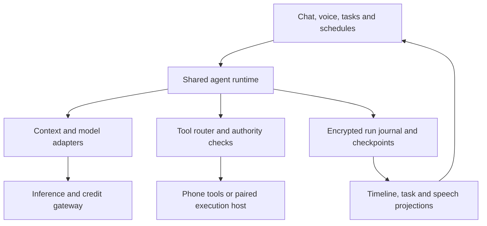

# KAI Agent Architecture Review and Implementation Plan

Version 1.0 | November 23, 2026 | Architecture proposal and implementation backlog

Prepared for Koinos AI. Android is the first implementation target; the contracts should also support a future KAI Core agent plugin and explicitly paired execution hosts.

## 1. Decision and intended product

Build one phone-owned agent runtime shared by chat, voice, saved tasks and scheduled work. Keep the existing encrypted memory, action approval and submission protections. Extract execution control from the screens and task worker into that runtime, with versioned provider, tool, storage and presentation interfaces.

The recommendation is to adopt the strongest contracts from OpenClaw and LibreChat, rather than transplant either complete application into Android. OpenClaw is principally a long-lived gateway and agent host. LibreChat is principally a server-hosted chat and agent platform whose agent SDK uses LangGraph. Their topology and operational requirements differ from KAI's current local-first phone model. [S01] [S12] [S31]

The competitive goal is a personal assistant that finishes useful work, explains exactly where it stopped, preserves progress, and can continue without repeating external actions. Its advantage should be understandable operation, trustworthy memory and source evidence, mobile voice, controlled spending, and access to the Koinos model network. Feature count alone is not evidence of a better agent.

The first cohesive release should prove the entire research-to-document journey: interpret the goal, research within a budget, prepare a useful draft, obtain exact approval, submit once, preserve the resource URL, verify what can be verified, and resume after interruption. The recent reports become acceptance cases for the new runtime, not a series of unrelated prompt patches.

### Decisions to make now

- One execution owner and state machine per run; UI components send commands and display projections.
- Separate run state, model-attempt state, tool-effect state, and speech-delivery state.
- Persist a run before it has an external action. Research must survive failures before an approval card exists.
- Keep canonical observations separate from model context, summaries and display history.
- Make capability, budget, recovery and authority checks shared services, used on every entry path.
- Continue using the user's selected model and credit policy; fallbacks are an explicit ordered configuration.
- Retain exact action approval, durable intent-before-submit and UNKNOWN reconciliation semantics.
- Add advanced delegation, code execution and a marketplace only after the core passes reliability gates.

## 2. Review method and evidence boundaries

This is a documentation and representative source review, with the current KAI implementation and supplied failure reports used as the baseline. It is not a line-by-line security audit of either upstream project, and no competitor runtime was executed or benchmarked during this review. Upstream feature descriptions establish implementation patterns, not guaranteed performance on KAI's accounts, models or phone.

| Project | Snapshot reviewed | Important qualification |
| --- | --- | --- |
| KAI Android | 0.4.32, commit `4f30648fa4547000df5bb639ffa32631c96ce628` | Baseline already has context projection, native-tool plumbing and strong action safeguards. |
| KAI gateway reference | `331a449192d5dbf752df25f848df5415f0223c06` | Source review does not establish production deployment or model activation. |
| OpenClaw | `ba2046d48e1784b79121a3de358534df73622760` | Main snapshot; latest release metadata observed was `v2026.11.7`. |
| LibreChat application | `4700c44eb77c142b4f9f8b87476924f22890eb39` | Main snapshot; the reviewed manifest says `v0.8.9`. A stable-release comparison was not established. |
| LibreChat agents SDK | `52dcccd5e09c9f24b018bbdd99925e637ef28517` | Manifest says `4.2.12`; a GitHub `v4.2.12` release was observed. |

Thirty-four upstream files were collected at those immutable references. Inspection concentrated on runtime ownership, graph routing, tool execution and replay, checkpoints, context budgeting, provider failures, deferred tools and host bindings. Large source files were inspected at relevant interfaces and control paths; collection does not imply every line was audited. Official documentation adds product, memory, plugin, browser, access-control and platform context. Some LibreChat documentation explicitly describes the latest development version.

Recommendations, proposed interfaces, priorities and acceptance targets below are KAI design judgments. They must be validated in implementation. User report identifiers, account IDs, document IDs, private contents and credentials are deliberately excluded from this deliverable.

## 3. What the reference systems actually separate

### 3.1 OpenClaw: a long-lived host with explicit execution boundaries

OpenClaw's gateway owns messaging integrations and exposes typed requests and events to clients and paired nodes. Its architecture makes a distinction between a client asking for work, a run being accepted, events being streamed, and a final outcome. A WebSocket connection or displayed message is therefore not the execution authority itself. [S01]

The reviewed runner establishes session and transcript ownership, serializes session work and enters global admission before acquiring a prepared runtime. Provider/model selection and lifecycle preparation sit around the attempt loop. Its tool policy path can block, require approval, or adjust parameters, with additional checks when approved parameters would change. These are useful examples of putting policy around execution rather than relying on the model to remember it. [S02] [S03]

Its failure machinery separates classification evidence from retry policy, including provider retry timing. Its agent-loop documentation also distinguishes malformed text calls, incomplete responses, settled tools, missing final answers and actual terminal failures. A recovery attempt must preserve completed work and cannot simply rerun an admitted task. [S04] [S35]

Other valuable patterns are bounded context compaction, retrieval from retained records, reusable skills, isolated child sessions, and dedicated browser profiles. These extend a runtime that already has identity, ownership and policy; they should not be treated as substitutes for those foundations. [S05] [S07] [S08] [S09]

### 3.2 LibreChat: a host application around a graph-based agent SDK

The agents SDK builds a graph around model, tool and summarization nodes. Its AgentContext owns provider-facing context and tool preparation. ToolNode handles execution, approvals, interrupts, result delivery and replay-sensitive tool batches. The application supplies persistence, policy, model setup and user-facing behavior around the SDK. This is a useful distinction between a reusable execution library and the product that hosts it. [S12] [S13]

The reviewed application has explicit turn origins and continuation strategies, a durable checkpointer integration and a tool-round budget hook. The budget hook reserves a final answer step and tells the model to converge as the remaining tool rounds diminish. That is materially better than permitting repeated calls after a tool's budget has already been exhausted. [S15] [S16] [S17]

The SDK host-binding contract separates model-visible schemas from host-authorized tool references. It explicitly warns that a call ID alone does not establish exactly-once external execution, and that a transport must reconcile uncertain effects before retrying. It also documents integration boundaries that are not yet complete across every remote host path. KAI should adopt the contract discipline without assuming every adapter has identical support. [S14] [S20]

LibreChat's ordinary resumable streams survive browser disconnection, but not the death of the process doing the generation. Durable approval/question checkpoints and opt-in background response handling have separate storage requirements. This distinction is essential when adapting the idea to Android. [S21] [S22]

### 3.3 What should not be copied wholesale

- Do not embed their complete Node/server stacks in the phone merely to obtain an agent loop.
- Do not move KAI's personal memory, connector credentials and approval authority into the inference gateway by accident.
- Do not equate a graph library, JSON schema or checkpoint with reliable external side effects.
- Do not expose every discovered tool or skill to every request.
- Do not assume an advertised model context window establishes tool compatibility or enough output allowance.
- Do not copy a provider's retry count across unrelated models, credit policies and Android lifecycle limits.
- Do not adopt multi-agent orchestration as the default for tasks that a single agent can finish cheaply.
- Do not mistake reference-project complexity for a clean design. The inspected Graph and ToolNode files are themselves large; their boundaries and tests are more useful than their file sizes or folder names.

OpenClaw's security guidance assumes a trusted gateway boundary, rather than hostile multi-tenant isolation. LibreChat has explicit role/resource access controls. KAI's personal phone and any future rented or shared agent execution need their own clearly documented trust boundaries. [S10] [S26]

## 4. KAI baseline: retain, consolidate, replace

KAI already has assets worth retaining: SQLCipher/Keystore-backed storage, source-evidenced structured memory, exact account and schema bindings, approval fingerprints, intent-before-submit, receipt retention, UNKNOWN outcome handling, privacy invalidation, native-call parsing, and the new context manager. Replacing all of that would create avoidable migration risk. [S29] [S39]

The main structural problem is that reusable helpers sit inside two separate execution controllers. Chat in `KaiViewModel` and saved work in `TaskAgentEngine` each coordinate inference, corrections, tools, policy checks and termination. A shared helper does not ensure those paths have the same lifecycle or recovery semantics.

| Current area | Retain | Required architectural change |
| --- | --- | --- |
| KaiViewModel | UI state and user commands | Move agent-loop ownership into a runtime service; observe run events instead. |
| TaskAgentEngine | Work scheduling and saved-task entry points | Become another adapter to the same runtime, with the same decision and recovery rules. |
| TaskRules and action store | Exact bindings, submitted-state transitions, receipts | Make this the sole mutation ledger used by every executor and presentation mode. |
| AgentHarness and NativeToolWire | Native registry, bounded parsing and call/result IDs | Put protocol negotiation and normalization behind a provider adapter. |
| AgentContextManager | Canonical/projection separation and bounded compaction | Integrate with persistent run checkpoints, a shared budget ledger and provider-specific metadata. |
| DocumentContentGuard | Prevent empty/duplicate/unverified completion | Replace broad reply interception with goal checks and evidence-backed finalization. |
| WebResearchSession | Public URL policy and topic/source controls | Persist findings; separate network, research and model budgets; detect lack of progress. |
| VoiceController and TurnLogic | Explicit microphone control, echo filtering, heard-text tracking | Drive them from runtime/presentation events with independent speech cancellation. |

### Failure evidence incorporated into the backlog

The earlier approval-resume failure was an input-assembly problem: a large saved checkpoint was inserted into pinned context before the next model call. Version 0.4.32 introduced bounded projection and archives, but ordinary chat research still needs durable progress before an external action exists.

The Kimi report showed a different boundary: an upstream response used its entire 2,048-token output allowance on reasoning, returned no answer, and ended at its token limit. Gateway classification turned this into generic provider unavailability. This requires model-aware output policy and typed failure propagation, not another context-size adjustment.

The GPT-OSS report showed 17 returned model responses, three protocol rejections, a three-search allowance exhausted, no successful page read and no document write. A document-specific completion guard replaced legitimate clarification/blocker text after two corrective prompts. This requires explicit run outcomes and a research convergence policy. Loosening action parsing or declaring success would not solve it.

The original voice cutoff remains an independent acceptance case. The supplied diagnostic reports do not prove an acoustic cause. Physical-device tests must distinguish echo-triggered interruption, user interruption, model failure, audio starvation and lifecycle cancellation.

## 5. Target architecture and ownership

Use a platform-independent Kotlin runtime module first. It should depend on interfaces and coroutine primitives, not Compose, Android microphone APIs or a specific model SDK. Android supplies encrypted storage, scheduling, connector transport and audio adapters. Establish language-neutral JSON Schema contracts and shared fixtures before considering another runtime language or a cross-platform rewrite.

Desktop KAI Core can later host an agent plugin implementing the same contracts. That does not require copying the Android UI loop into TypeScript or putting orchestration in the credit service. A future remote executor is an explicitly paired execution owner, separate from an inference provider.

| Layer | Owns | Must not own |
| --- | --- | --- |
| Presentation | Input, timeline, approval/question panels, speech playback | External submission, retry policy or completion truth. |
| Agent runtime | Run transitions, ownership, planning, budgets, dispatch and finalization | Provider credentials embedded in prompts or UI-specific state. |
| Context service | Retrieval, source references, projections, token accounting and compaction | Action approval or canonical mutation of observations. |
| Model adapter | Capability-specific request/stream mapping and typed outcomes | Tool execution or arbitrary access to connector secrets. |
| Tool and policy services | Schema validation, exact authorization and execution routing | Model-invented account identity or implicit authority from a tool name. |
| Store and journal | Durable facts, checkpoints, leases, intents and receipts | Treating a summary or display message as an execution receipt. |
| Inference gateway | Account/model admission, metering, capability publication and transport | Phone memory, task planning or the user's Composio project key. |

The dependency direction is deliberate: screens depend on the runtime; the runtime depends on ports; adapters implement ports. A new UI surface or connection should not create another agent loop.

## 6. Runtime contracts, persistence and completion

### 6.1 A run is more than a model response

Define an explicit GoalContract from the user's request: desired outcome, create-versus-edit intent, target resource when known, required content, source expectations and completion evidence. The contract guides work; it does not authorize external actions. Optional research details should use reasonable defaults. A request to create a document does not require an existing document ID.

The model may propose a next tool call, draft answer, clarification, plan revision or blocker. The runtime validates that proposal against current facts and policy. A provider's normal stop signal means generation ended, not that the user's goal was achieved. A final response is assembled from the validated goal state, tool receipts and retained findings.

| Run state | Meaning | Safe next behavior |
| --- | --- | --- |
| QUEUED | Admitted work waiting for an execution owner or resource | Claim the same run; do not create another copy. |
| RUNNING | An owner is preparing or executing the next bounded step | Recheck ownership and privacy before effects. |
| WAITING_INPUT | A specific decision or fact is genuinely needed | Persist the question and resume with the answer. |
| WAITING_APPROVAL | An exact external action awaits review | Resume only the current reviewed intent. |
| PAUSED | User or platform has suspended execution | Retain progress and explain how to continue. |
| PARTIAL | Useful findings or effects exist, but required work remains | Show what is available and the actual remaining blocker. |
| RECONCILING | A submitted effect has an uncertain outcome | Inspect receipts/service state; never automatically repeat it. |
| COMPLETED | Required goal evidence is satisfied | Show the result and its verification level. |
| FAILED or CANCELLED | No further automatic execution is scheduled | Preserve completed effects and recoverable findings. |

Keep a separate effect state for each tool invocation: PREPARED, AWAITING_APPROVAL, ADMITTED, SUBMITTED, ACCEPTED, VERIFIED, FAILED_BEFORE_SUBMIT, UNKNOWN or CANCELLED_BEFORE_SUBMIT. Cancelling a run cannot undo an already submitted action. Run completion, service acceptance, content verification and audible playback are separate facts.

### 6.2 Durable records and single ownership

| Record | Required information |
| --- | --- |
| Run | Goal contract, conversation/project scope, origin, owner, privacy epoch, schema revision, current state and budgets. |
| Turn and step | Input revision, parent relationships, current plan step and why it is waiting or stopped. |
| Model attempt | Model/route and capability snapshot, request identity, requested limits, usage, normalized finish and typed failure. |
| Tool invocation | Host-issued ID, exact account/tool/version/schema, canonical arguments, side-effect class, authorization and submission state. |
| Observation | Original result or content reference, retrieval time, source identity, trust and assurance level. |
| Approval | Exact reviewed scope, fingerprint, expiry, owner and revocation/current-generation checks. |
| Checkpoint | Last committed event sequence, state snapshot, tool-result references, budget counters and necessary adapter replay state. |
| Projection | Derived UI history, provider messages and speech segments; never the authoritative effect ledger. |

Use the encrypted database for a bounded event journal plus snapshots and separately stored result/artifact payloads. Do not turn the entire application into a new event-sourcing framework before the core needs it. Existing action records remain canonical; introduce a versioned run/event schema alongside them.

Claim a run with a lease and compare-and-set revision. Every asynchronous callback carries run, step, attempt and generation identifiers. Recheck the claim before saving a result and immediately before an external submission. A stale UI, worker or provider callback cannot adopt a replacement run. One owner serializes mutations even when independent reads execute concurrently.

Checkpoint before inference dispatch, before an authorized external effect, after each completed tool result, and at every pause/terminal transition. Persist receipt and state changes atomically where local storage permits. External services remain outside that database transaction: exactly-once execution cannot be guaranteed by a local call ID. Use service idempotency when supported and reconciliation when an outcome is uncertain. [S14] [S20]

Ordinary research should have a Run record even when no AgentTask/write intent exists. Resume from the latest checkpoint and observation references, rather than rerunning the original natural-language request. For an in-flight model call after process death, follow the gateway's request/settlement contract; do not assume an unanswered HTTP request was free or had no remote work.

Journal immutability must not defeat Forget. Store private content behind erasable references, invalidate snapshots and indexes on privacy changes, and retain deletion markers against old imports. Keep only the submitted-operation evidence needed for reconciliation under its existing protection; do not reintroduce forgotten content into future prompts. Temporary chats use ephemeral run storage and must not leak into durable extraction or replay.

### 6.3 Completion verification without forced success

Replace the current broad document-reply interception with a goal-verifier interface. Verifiers examine phone-owned evidence, not just wording. They must reject unsupported claims of writes while permitting honest questions, blocked states and partial results.

For a researched document, the default goal includes a title, meaningful body, source links, a real resource reference and a stated verification level. A body-capable create action cannot be reviewed with an empty body. Once creation is accepted, later steps reuse that resource. Readback checks the same account and resource after the write. If readback is unavailable, the final state reports accepted but unverified work; it does not invent a verified success or repeat the write.

A blocker must identify an actual missing prerequisite. A new-document goal cannot become blocked merely because no document ID exists yet. A network/search budget problem must not become a request for account credentials. If the model proposes a clarification, the host checks whether the answer is already present in the goal, account facts or receipts before bothering the user.

Reserve a bounded, tool-free finalization step when research or tool budgets are exhausted. Its input is the retained findings and actual effect states. It reports what happened and what remains; it cannot create a second opportunity to submit tools or hide unresolved failures. OpenClaw documents a similar distinction between settled tool work and its final answer. [S35]

## 7. Model, context and recovery design

### 7.1 A capability profile for each actual route

Maintain a versioned ModelProfile for the serving route, not just a display name. Include native function support, supported schema subset, parallel-call policy, request API dialect, output-limit parameter, reasoning controls, context limits, output ceiling, request-byte limit, replay requirements, timeout behavior and pricing/usage semantics.

Distinguish advertised limits, served limits, configured limits and observed usage. Capability discovery is not permission to execute tools. Tool support must be tested through a complete call/result/follow-up exchange, including fragmented streams and any required provider replay metadata. A one-shot model saying a function name is insufficient evidence.

Normalize provider output into answer deltas, tool-call fragments, usage, normalized finish, refusal and typed error events. Keep raw protocol tokens and incomplete argument JSON out of normal chat and speech. Native calling is the preferred path for verified routes; a bounded JSON adapter remains for other models. Both produce the same runtime decisions and pass through the same policy gate.

Provider-specific reasoning needs special treatment. Some APIs count reasoning within their output allowance; some require replay metadata for later tool turns. Do not treat internal reasoning as answer text. Keep any strictly required replay material private, bounded and adapter-owned, with explicit retention and privacy handling. If a route cannot satisfy both its protocol and KAI's policy, mark the capability unsupported instead of guessing. [S27] [S36]

Model defaults must leave enough generation room for reasoning and the answer. The present 2,048-token default is not a universal agent policy. Set defaults from validated model profiles and task needs, with a user-visible spending ceiling. Increasing the output allowance is useful only if the provider accepts the request and the account policy permits it; it is not a reason for an unlimited retry ladder.

### 7.2 One recovery controller

Typed failure propagation must preserve the underlying cause across provider, gateway, SDK and app boundaries. Keep safe diagnostic codes and facts even when human-facing error text is simplified. HTTP 200 with an application error, HTTP 502, output exhaustion and a network disconnect are not interchangeable.

| Failure | Recovery policy |
| --- | --- |
| Input/context limit | Rebuild a smaller projection, recalibrate estimates and retry within a small budget. |
| Reasoning-only output at length limit | Classify explicitly; change the allowed generation plan or choose an authorized fallback. Repeating identical settings is not progress. |
| Malformed or incomplete tool proposal | Never execute the fragment. Request a bounded correction or supported native reissue. |
| Rate limit or overload | Respect provider timing, use bounded backoff and configured model fallback where permitted. |
| Authentication, access, insufficient credits | Pause with the appropriate account action; do not rotate credentials or spending policy silently. |
| Missing tool, invalid schema or target | Refresh/inspect the relevant capability once; stop repeated guesses. |
| Read-only tool failure | Retry or choose another source when safe and useful, with the failure cached and counted. |
| Uncertain external write | Reconcile; zero automatic write replays. |
| Budget exhausted or no progress | Save PARTIAL work, finalize from evidence and offer a resumable continuation. |
| User cancellation or privacy change | Stop admission, invalidate stale work and retain submitted-operation truth. |

Separate per-attempt, per-step and whole-run ceilings for time, retries, tokens, network operations and cost. Reserve a finalization allowance. Initial policies can use at most two format repairs per step and at most two quality-revision cycles, but all attempts also consume a whole-run budget. Tune defaults with the evaluation suite, not by scattering constants across controllers.

Configure a primary model plus ordered, optional fallbacks. Enforce the user's data-routing, account, wallet, free/paid and price constraints for every candidate. Rebuild each candidate's prompt using its own capability profile. Protocol switching belongs in the adapter and checkpoint migration path; do not feed an incompatible provider's wire transcript directly to the next model. [S04]

### 7.3 Context as a projection service

Extend the existing context manager rather than discarding it. Budget instructions, current goal, tool schemas, conversation, retrieved evidence, reasoning/output allowance and transport bytes together. Use a route-appropriate tokenizer when available and conservative calibrated estimates otherwise. Preserve complete recent call/result groups and necessary exact schemas.

Prefer cheap deterministic pruning and old-output masking before summarization. Summaries remain lossy navigation aids to original records. Retain resource IDs and action facts in the ledger, and expose bounded retrieval of earlier observations. Refresh summaries from canonical records, not endless summaries of summaries. Cache stable prompt/schema prefixes only within matching privacy and capability revisions. LibreChat's reviewed compaction and schema-counting paths demonstrate the value of accounting for the actual bound tool inventory. [S18] [S40]

## 8. Tools, research, memory and artifacts

### 8.1 A generic tool pipeline

Use one ToolDescriptor: stable namespace, account/owner binding, schema/version, input/output limits, side-effect class, idempotency/reconciliation support, deadline, cancellation and permission requirements. Composio is an adapter to this interface. MCP and a future paired desktop executor are other adapters. Connections should add schemas and transport configuration, not connection-specific branches in the Android agent loop. Unknown side effects require review by default; a model-supplied read-only label cannot lower that requirement.

The pipeline is discovery, policy filtering, model exposure, proposal validation, approval if required, durable admission, execution, result validation, checkpoint and optional verification. Revalidate identity, schema, arguments and authority after approval and immediately before submission. Tool discovery and successful execution must remain different facts.

Defer large catalogs. Expose a small discovery surface and load only relevant exact schemas. Pin what was approved. Namespace collisions or a server changing a tool definition must not silently inherit an earlier approval. Support bounded concurrency for independent reads; serialize mutations by default. Mixed batches must not rerun completed siblings after an approval pause or question. [S13] [S19] [S20] [S25]

Keep per-action review as the default. Broader run/session grants are a later, explicit product feature with account, tool, resource, expiry, write-count and revocation boundaries. A model's requested intent label is not authority. Arbitrary plugin code, shell commands and browser actions require an executor whose isolation and permissions are separately defined.

### 8.2 Research should converge to a usable result

Create a durable ResearchState containing the question, coverage, candidate projects, normalized URLs, source excerpts, retrieval outcomes, confidence/verification level and remaining work. Keep search snippets, fetched pages and user-supplied evidence distinct. A project description must reference evidence that actually supports it.

Use query and URL deduplication, failure caching, alternative-source selection and a no-progress detector. Track actual network attempts separately from model steps and policy-denied calls. A denied call should not pretend another network request occurred, while a global step ceiling still prevents repeated denied calls forever.

Replace the three-search dead end with a bounded task-level research allowance that can continue across saved turns. Warn before the allowance is consumed, stop broadening the search, and reserve time to prepare a result. When tools are exhausted, narrow the exposed tool surface and enter finalization or a paused state instead of asking the model to keep trying unavailable operations. LibreChat's budget hook and continuation UI are useful patterns here. [S16] [S23]

Record web errors precisely enough to distinguish timeout, HTTP denial, TLS/DNS failure, unsupported content, empty extraction and URL-policy refusal. One blocked page is not proof the phone has no internet. For JavaScript or authenticated sites, use a separately authorized browser/connector route or report that limitation. Do not silently bypass public-URL protections.

Offer a partial draft with clear evidence limits when that is useful. Unsupported claims and invented links remain disallowed. The model should not ask again how many projects to include when the user already said as many as can be found; it should report coverage and remaining work.

### 8.3 Personal memory and document retrieval stay distinct

Preserve KAI's structured, source-evidenced personal memory, stable identities, corrections, confirmations and deletion rules. OpenClaw's workspace notes and retrieval illustrate useful working-memory layers, but replacing KAI's identity graph with automatically trusted Markdown would lose existing guarantees. [S06] [S39]

Add project/file retrieval as a separate service with document revisions, chunk references, scoped search, citations and deletion invalidation. Small documents can enter context directly; larger collections need retrieval. A top-k search result is not a complete document review. Summarization and exhaustive audit tasks need coverage-aware retrieval or whole-document processing. LibreChat explicitly distinguishes file search from full extracted-text context. [S24]

Store generated drafts, source lists and service-produced resources as artifacts with versions, provenance, MIME type and scope. A draft is not an externally published document. Maintain the distinction between a local artifact, a prepared external action, an accepted service write and verified content.

## 9. Voice, mobile execution and user control

Voice should be a presentation/input adapter over the same run, with its own speech session ID, phrase sequence, playback cursor and interruption reason. It must distinguish explicit user interruption, probable echo, TTS failure, model failure, audio starvation and app lifecycle changes. Text-pattern echo filtering is not acoustic echo cancellation.

Only eligible answer/narration text may reach TTS. Tool argument fragments, provider control markup and private reasoning must not be spoken. Once text is audible, later recovery cannot silently replace that history. Keep generated, displayed and heard text separate, and use only the heard portion where conversational context depends on what the user actually heard.

A Stop speaking action stops playback. A Stop task action stops further run execution. The UI must explain the difference. Cancelling an in-flight write cannot promise the service did nothing. Preserve the user's interrupted speech and fence late ASR, model and audio callbacks by their original generation.

Android does not provide the same always-running server model as LibreChat. Long user-visible tasks need the appropriate foreground execution path and notification; deferred tasks use scheduling/checkpoints. Android 16 can apply job quotas even to long-running WorkManager workers. Validate against current platform rules, battery restrictions and the target SDK before promising uninterrupted background execution. [S28]

Support queue and steer commands at safe runtime boundaries, with revision checks so a late model answer cannot ignore newly accepted input. A lightweight plan is useful for multi-step work, but ordinary chat should not pay for a mandatory planner and reviewer chain. Quality gates should be bounded and must not turn every task into a multi-agent workflow.

## 10. Security, extension and product boundaries

Keep credentials outside prompts, exported diagnostics and model-generated configuration. Separate KAI inference account/credits from connector authorization. Retain the current user-owned Composio project-key mode. For mainstream onboarding, evaluate an optional per-user OAuth broker as a separate product/security decision; never place a publisher-wide connector key in the APK.

Treat web pages, tool outputs, files, skills and delegated results as untrusted content. Tool availability, memory confirmation, a skill instruction and a model plan cannot grant execution permission. Private network access, filesystem paths, browser sessions and code execution require host-enforced capabilities, not prompt-only rules.

Use versioned skills and saved-agent templates for repeatable procedures after the runtime is stable. A workflow builder must edit a declarative graph consumed by this same runtime, with per-node model selection and bounded revision loops. Graph import/export is a compatibility boundary, not a second execution engine. Declare required capabilities, input/output contracts and compatibility. Validate imports without executing bundled code or granting permissions. A skill marketplace needs provenance, version pinning, dependency review, revocation and safe removal before public installation becomes easy. [S07] [S34]

Introduce subagents only where measured quality or latency improves. Start with isolated, read-only research/review workers, inherited budget ceilings and narrow context. Parent/child results and costs need their own identities. A child cannot inherit broader account authority or turn its output into a write approval. OpenClaw's separate child sessions and LibreChat's graph/tool lifecycle provide patterns, not a reason to spawn helpers on every request. [S08] [S12]

Browser automation and programmatic tool loops belong in an explicitly paired, isolated execution environment first. Android should not become an unrestricted shell or assume every MCP stdio server can run on a phone. Preserve a human authentication/approval path for signed-in browser actions. Rented/shared agents must never inherit the owner's private memory or accounts by default. [S09] [S10] [S14]

A future multi-device experience needs explicit execution ownership, encrypted data-sharing decisions and conflict handling. Synchronizing a transcript is not transferring authority to run it. The decentralized model provider remains an inference service unless the user separately pairs an execution host.

## 11. Implementation sequence and migration

The companion CSV contains 64 capability items with priority, phase, current baseline, acceptance criterion, dependencies and source references. P0 means core reliability or protection required for the first cohesive runtime. P1 adds useful capability after the contracts work. P2 is strategic expansion or an explicit product decision. These are work packages and release gates, not calendar promises.

| Phase | Deliverable | Exit gate |
| --- | --- | --- |
| 0. Contracts and baseline | Goal/run/effect/error schemas, failure fixtures, threat model, capability probes, baseline measurements and license inventory. | Current behavior is reproducible; interfaces and supported profiles are explicit. |
| 1. Runtime and durable state | Shared controller, encrypted run journal, snapshots, leases, command/event interfaces and legacy-run routing. | Ordinary research survives restart; stale owners cannot dispatch; existing action records migrate without changed authority. |
| 2. Providers and recovery | Capability profiles, normalized streams/errors, reasoning/output budgets, native transport qualification and bounded fallback. | Both captured models have truthful failure outcomes; native qualification includes a real multi-turn tool exchange. |
| 3. Unified tool lifecycle | Tool router, deferred schemas, policy/approval integration, result attribution and reconciliation. | Crash and approval-resume tests cannot automatically duplicate a submitted write. |
| 4. Research and completion | Persistent findings/drafts, no-progress control, source assurance, goal verification and question/partial-result controls. | The research-to-document journey succeeds or pauses usefully with recoverable work and an accurate reason. |
| 5. Android and voice | Foreground/scheduled execution adapters, speech lifecycle, queue/steer behavior and user-facing run timeline. | Physical-device lifecycle and audio acceptance passes; partial runs never look falsely completed. |
| 6. Extensibility and knowledge | MCP adapter, saved agents/skills, a shared workflow format/builder, scoped file retrieval, artifact versions and a host SDK. | A third party can add a supported adapter without changing the runtime or widening permissions. |
| 7. Differentiated expansion | Measured subagent use, paired browser/code host, optional cross-device ownership, marketplace/rental isolation. | Each feature demonstrates measurable benefit and passes its new authority/lifecycle tests. |

Phases are not eight isolated releases. Phases 1-4 should produce one integrated vertical slice before a broad rollout. Phase 5 is required before claiming production Android/voice reliability. Small, urgent repairs should enter these interfaces and tests; they should not add another owner of execution or another unrelated retry loop.

### 11.1 Extract responsibilities before reorganizing files

Start with packages and explicit interfaces. Split Gradle modules only after the dependency boundaries are useful and testable. Candidate modules are agent core, encrypted run repository, model adapters, tool adapters, context/retrieval and Android execution/presentation adapters.

| Existing code | Intended destination or role |
| --- | --- |
| KaiViewModel.runAgentTraced | RunController and command adapter; the view model subscribes to projections. |
| TaskAgentEngine.runClaimed | Scheduled/saved-run adapter plus shared RunController. |
| AgentResponseRecovery and context-overflow branches | RecoveryController using typed model outcomes and one budget ledger. |
| AgentHarness, AgentProtocol and NativeToolWire | Protocol adapters producing common validated decisions. |
| DocumentContentGuard | GoalVerifier and service-specific evidence checks, preserving duplicate/body protections. |
| WebResearchSession | ResearchPlanner/ResearchState and public-web tool adapter. |
| KaiStore, TaskRules and WorkspaceStore | Retained canonical store behind a RunRepository interface and versioned migrations. |
| VoiceController, StreamingSpeechSession and TurnLogic | Android speech adapter and pure speech-state reducer. |
| Gateway managed-provider and native-chat | Backward-compatible typed inference outcomes, capability publication and signed/metered transport. |

Do not start by rewriting memory, voice assets, UI rendering or connector transports. Introduce ports around working implementations, then move control into the kernel one responsibility at a time. Keep the existing signing identity and encrypted database; do not reset user data to simplify a migration.

### 11.2 Migration and rollback rules

1. Add schema versions, run IDs and the new journal additively. Verify encrypted reopen, export/import boundaries and retention before enabling new execution.
2. Capture synthetic and redacted trace fixtures. Compare pure decisions/projections in shadow mode with simulated effects, never by submitting the same real action twice.
3. Route each run to one engine version at creation. Start with internal/read-only cohorts, then newly created user runs. Drain older active work through a compatibility adapter.
4. Preserve pending approvals exactly. If an old checkpoint cannot safely migrate, hold it with an actionable reason and its receipts; do not guess replacement arguments or silently abandon it.
5. Move chat, saved-task and scheduling entry points to the shared runtime under explicit cohort flags. A run's owner and schema determine its route, not whichever screen opened most recently.
6. Roll back new admission separately from already admitted work. Existing submitted actions remain reconcilable; disabling a feature must not replay or erase them.
7. Remove the legacy loop only after all entry points, paused states, privacy changes and import/restart cases pass the same suite.

Gateway and app rollout must be compatible in both directions. Publish capability changes only after the server path and per-model probe pass. An APK containing a native registry is not proof that the live gateway or selected model can use it. Preserve signed usage and credit accounting while adding richer error/usage metadata.

## 12. Evaluation, competitive claims and release gates

### 12.1 Baseline and fairness

Build a reproducible evaluation harness around the runtime's interfaces, with fake clocks, deterministic transports and a simulator for external effects. Turn the supplied reports into small synthetic fixtures rather than publishing private transcripts. Add property/state-machine tests for ownership, effect transitions and privacy invalidation, and adapter conformance tests for every supported route.

Compare KAI 0.4.32 and the new runtime using the same task set, account policy and model routes. Where possible, run equivalent tasks on OpenClaw and LibreChat with the same provider/model, tool definitions, source corpus and spending allowance. Publish differences in prompts, platform, native tool support or available services instead of presenting an unfair score as product superiority.

Use both deterministic web fixtures and separate live-web trials. Fixtures establish repeatable control-flow behavior; live trials expose actual blocking, page changes and extraction weaknesses. Source quality and document correctness need independent review. A run that produces a plausible paragraph is not automatically a successful task.

### 12.2 Required scenarios

| Scenario group | Minimum acceptance behavior |
| --- | --- |
| Captured context/resume failure | Large archived results fit a bounded prompt; current goal and exact submitted-operation facts remain available. |
| Captured Kimi reasoning exhaustion | Length/zero-answer/reasoning usage is classified accurately; recovery changes a meaningful condition or stops with preserved work. |
| Captured GPT-OSS loop | Mixed/multiple JSON cannot execute; exhausted research reaches an honest question/partial result without canned account confusion. |
| Native protocol | Fragments, UTF-8, strict schemas, call/result IDs, tool batches, provider replay metadata and approval resumes round-trip correctly. |
| Research grounding | Wrong-name organizations, unsupported project links, stale pages and snippet-only evidence cannot become verified claims. |
| External effects | Crash before/after dispatch, lost response, duplicate callbacks and restart preserve intent/receipt truth without automatic write replay. |
| Ownership and steering | Simultaneous resume, changed goal, revoked account and stale callback cannot seize a new run or its approval. |
| Memory and privacy | Forget, temporary chat, corrected facts, project deletion, stale indexes and old imports cannot revive forbidden context. |
| Voice and lifecycle | Echo, real interruption, headphone route, audio failure, backgrounding and model errors have different observable outcomes. |
| Budgets and credits | Retries, summary, finalization and children are attributed; no silent switch of wallet, provider policy or paid/free setting. |
| Extension boundaries | A hostile tool/skill result cannot install code, grant itself authority or escape its host scope. |

### 12.3 Proposed release gates, not measured results

- All deterministic safety and regression fixtures pass. Within those tests, observe zero unauthorized submissions, automatic replays of UNKNOWN writes, mismatched approvals or restored forgotten content.
- Every known failure class terminates within its budget and reports the correct next action. A resumable state must actually resume with its retained findings.
- Establish a held-out set of at least 30 representative user tasks. Use a provisional target of at least 90% verified goal completion on supported model profiles, with cost and failure categories published. Confirm or revise the target after Phase 0 baseline measurements; do not call it achieved in advance.
- Report useful partial outcomes separately from completed tasks, and report accepted-but-unverified writes separately from verified completion.
- Measure p50/p95 total latency, time to first useful result, model/tool calls, token and credit usage, no-progress calls, context retention and resume success.
- Measure storage/checkpoint latency, memory, battery behavior and background recovery on representative Android devices. Establish limits from measurements before marketing long-running reliability.
- Run physical speaker, headset and Bluetooth tests for voice. Emulator audio/control-flow tests cannot establish naturalness, echo resistance or phone latency.
- Perform final live end-to-end trials with recorded approval and service receipts. Synthetic success alone cannot qualify a production tool route.

Qualify capabilities separately: chat-ready, tool-ready, reasoning-agent-ready, long-task-ready and voice-ready. A network model being available or eligible for earning does not establish native agent-tool compatibility. Agent qualification should not silently alter unrelated provider reward eligibility.

## 13. Product scope and deliberate deferrals

KAI can compete by making work understandable and recoverable on a personal device. The first product promise should be narrow and measurable: source-backed research, controlled document/email/calendar work, remembered user preferences with evidence, and reliable continuation. The UI should show searching, waiting for review, accepted/verification pending, paused with results, reconciling, or complete using runtime facts.

Saved agents and skills should make common tasks repeatable without exposing developer terminology to ordinary users. Developer detail belongs in advanced inspection and diagnostic exports. Connection setup, permission review, file access and budget controls need clear ordinary-language flows.

Defer broad autonomous computer control, arbitrary phone-side code execution, multi-agent swarms, open extension installation, seamless multi-device execution and public agent rentals until their dependencies pass. These features are valuable under the right contracts; they are expensive ways to amplify an unreliable kernel when added too early.

Do not promise universal model support, unlimited context, exactly-once behavior from arbitrary services, or uninterrupted Android execution. Publish supported capability profiles and measured limits instead. A smaller surface that finishes reliably is a stronger starting product than a large surface whose failures lose the user's work.

### Questions resolved by the recommended defaults

- Keep the phone as the default owner of personal state and connector authority.
- Build a Kotlin runtime around existing implementations; share contracts and conformance fixtures across future hosts.
- Use native tools only on qualified routes; retain a safe legacy adapter.
- Prefer a single agent and bounded independent reads before adding subagents.
- Keep exact per-action approval by default; broader grants require explicit bounded policy.
- Make continuation, partial results and precise blockers normal product outcomes.

### Decisions that remain explicit future work

- Which remote execution host and pairing protocol to support first.
- Whether to introduce a per-user OAuth connector broker and how its ownership/cost model works.
- Which model profiles qualify for automatic fallback, and their per-run spending ceilings.
- Whether cross-device data synchronization is offered, with which encryption and recovery model.
- Which extension/skill formats are worth supporting beyond a documented KAI contract.
- How much agent/workflow compatibility to share with KAI Core after the Android runtime is proven.

## 14. First implementation batch

Begin with Phase 0 contracts and an integrated Phase 1-4 vertical slice. The concrete first batch is a shared RunController, RunRepository, ModelProfile/normalized outcomes, RecoveryController, ToolRouter, ResearchState and GoalVerifier, with chat and saved tasks as adapters.

The demonstration must use the original class of task: find Koinos projects, prepare descriptions with real source links, create one reviewed document, retain its real link and verify or accurately qualify the contents. Inject a model output-limit failure, a blocked source page, a malformed action response and an app restart along the journey. The user should be able to continue the same work at each recoverable point.

The original source/effect protections remain acceptance requirements. Passing this journey establishes the foundation for the larger backlog; it does not establish every future marketplace, browser or delegation feature.

## 15. Initial engineering contracts

These are proposed interfaces to make the implementation concrete. They are not a claim that the refactor has been implemented.

### 15.1 Commands and events

The public runtime surface needs three operations: create a run from a goal and admission policy; send a version-checked command; and observe events after a known sequence. Commands include SubmitInput, Resume, DecideApproval, AnswerQuestion, Steer, Pause and Cancel. Commands carry an idempotency key, expected run revision and the current actor's authority.

Command acceptance is not task completion. Return a receipt with command ID, run ID, accepted/rejected/indeterminate status and committed sequence when known. A duplicate command returns its existing receipt. A stale approval refers to an exact pending action and cannot be retargeted to the newest action.

Events include RunAdmitted, OwnerClaimed, ModelAttemptStarted, ModelOutcomeRecorded, ToolPrepared, ApprovalRequired, ToolSubmitted, ToolResultRecorded, QuestionRequired, BudgetLow, RunPaused, GoalVerified and RunFinished. Include schema version, run/step/attempt/invocation IDs as applicable, monotonic sequence and privacy revision. Content is a scoped reference where possible. Presentation cannot manufacture these events to authorize work.

An observer that disconnects can replay retained events after its last sequence. Event replay updates the UI; it does not execute tools. A speech adapter also tracks its own delivered cursor, so replaying text does not automatically replay audio. If history was pruned, return a current snapshot plus its sequence rather than pretending the missing events were delivered.

### 15.2 Ports and responsibilities

| Port | Minimum responsibility |
| --- | --- |
| RunRepository | Claim/version checks, append events, commit snapshots, store observations, privacy invalidation and legacy loading. |
| ModelAdapter | Resolve profile, prepare a compatible request, stream normalized events, return typed outcome and authoritative usage facts. |
| ContextService | Produce a budgeted projection with source references; retrieve original permitted records; request budgeted summarization if needed. |
| ToolRegistry | Discover policy-eligible descriptors, inspect/pin schemas and resolve an invocation to an authorized transport. |
| PolicyService | Evaluate capability, account/resource scope, approval validity, side-effect policy and current actor/epoch. |
| ToolExecutor | Execute an already admitted invocation with a deadline; report accepted/result/unknown facts; never decide a new approval. |
| BudgetLedger | Reserve and settle run/attempt/tool budgets, attribute usage and expose remaining allowance without changing credit policy. |
| GoalVerifier | Check required outcomes against observations/receipts and produce complete/partial/blocked evidence. |
| Scheduler and speech ports | Translate platform lifecycle and playback facts into runtime commands/events without becoming execution owners. |

### 15.3 Normalized failure example

For the Kimi case, the adapter should preserve the following class of facts: kind=model_output_exhausted, stage=response_validation, provider_status=200, finish_reason=length, visible_answer_characters=0, reasoning_tokens=2048 and requested_output_tokens=2048. Identifiers are correlators, not authority. The exact wire fields should be versioned and allowlisted.

The runtime then chooses recovery from those facts, its current budget, supported model settings and the effect ledger. The provider adapter must not declare that replaying a tool is safe. An ordinary upstream overload with HTTP 503 yields a different failure kind and uses provider timing rather than a larger output budget.

### 15.4 Required execution order

1. Validate the command and claim the current run revision; reject stale ownership or invalid privacy scope.
2. Load canonical state and pending effects. Reconcile unknown submissions before considering another mutation.
3. Select the next goal step and resolve the actual model/tool capabilities and permission surface.
4. Admit the model/context work against the budget. Persist an attempt and build the bounded projection; account for any summary calls separately.
5. Normalize the model outcome. A malformed proposal cannot create an external intent; a typed failure enters the shared recovery policy.
6. Validate a tool proposal against exact schema, account, target, budget and current policy. Obtain review when required.
7. Persist the authorized intent and recheck current authority immediately before dispatch. Submit through the sole executor.
8. Commit observations, receipts, effect state and checkpoint. Unknown outcomes remain unknown until reconciled.
9. Evaluate progress and the goal. Continue, ask, pause, finalize partial work or finish with the supported verification level.
10. Release execution ownership only after the durable outcome is committed. Cancelled callbacks cannot append to a successor run.

This order is the core product contract. Prompts and skills can help the model choose well, but cannot replace it.

## 16. Capability inventory

The CSV is the actionable backlog: all 64 items include dependencies and an acceptance criterion. The compact inventory below makes the full scope visible without implying that all features belong in the first release. Existing protections are marked for retention and consolidation rather than reimplementation.

| ID | Capability | Priority / phase | Current baseline |
| --- | --- | --- | --- |
| KAI-001 | One shared execution kernel | P0 / 1 | Two coordinating loops |
| KAI-002 | Explicit run and outcome states | P0 / 0-1 | Partial enums and reply-driven termination |
| KAI-003 | Encrypted run journal and snapshots | P0 / 1 | Action and saved-step persistence exists |
| KAI-004 | Single writer and stale-callback fences | P0 / 1 | Epochs and saved-run leases exist |
| KAI-005 | Create/edit and prerequisite contract | P0 / 1-4 | Document heuristics |
| KAI-006 | Evidence-backed finalization | P0 / 4 | Broad document reply interception |
| KAI-007 | Checkpoint each completed tool step | P0 / 1 | Chat archive mainly at approval |
| KAI-008 | Versioned legacy-run adapter | P0 / 1 | Old checkpoint decoding exists |
| KAI-009 | Typed errors across gateway and app | P0 / 0-2 | Generic inference exceptions |
| KAI-010 | Route capability registry | P0 / 2 | Catalog context/output/native flag |
| KAI-011 | Reasoning-aware output budgets | P0 / 2 | Common 2048-token request default |
| KAI-012 | Private provider replay metadata | P0 / 2 | No general replay-metadata contract |
| KAI-013 | Normalized streaming events | P0 / 2 | SSE and native fragments exist |
| KAI-014 | Gateway native capability rollout | P0 / 2 | Reference code exists; inactive in reports |
| KAI-015 | Full native tool conformance | P0 / 2-3 | Generic registry and IDs exist |
| KAI-016 | One bounded recovery controller | P0 / 2 | Separate format/context corrections |
| KAI-017 | User-configured ordered fallbacks | P0 / 2 | No unified chain |
| KAI-018 | Shared time/token/tool/cost ledger | P0 / 1-2 | Several local counters |
| KAI-019 | Common tool descriptor and router | P0 / 3 | Composio-specific runtime integration |
| KAI-020 | Pinned schema and argument validation | P0 / 3 | Implemented safeguards |
| KAI-021 | Account and credential-generation binding | P0 / 3 | Implemented safeguards |
| KAI-022 | Exact per-action review | P0 / 3 | Implemented fingerprints |
| KAI-023 | Durable intent and receipt ledger | P0 / 3 | Implemented action states |
| KAI-024 | Stable call/result attribution | P0 / 3 | Native IDs and checkpoints exist |
| KAI-025 | Bounded independent-read concurrency | P1 / 3 | One action per model step |
| KAI-026 | Explicit uncertain-outcome reconciliation | P0 / 3 | UNKNOWN protection exists |
| KAI-027 | Deferred tools and schema budgets | P0 / 3 | Discovery/inspection and bounded registry exist |
| KAI-028 | Persistent research findings and coverage | P0 / 4 | Transient WebResearchSession |
| KAI-029 | Query/URL normalization and failure cache | P0 / 4 | No shared no-progress controller |
| KAI-030 | Precise fetch and extraction failures | P0 / 4 | Generic unavailable messages |
| KAI-031 | Budget-aware convergence and continuation | P0 / 4 | Three-search dead end |
| KAI-032 | Claim/source assurance ledger | P0 / 4 | Topic/link heuristics |
| KAI-033 | Draft before external submission | P0 / 4 | Body validation but no durable draft workflow |
| KAI-034 | Canonical records and bounded projection | P0 / 2-4 | Implemented in 0.4.32 |
| KAI-035 | Tokenizer and usage calibration | P1 / 2 | Conservative UTF-8 estimates |
| KAI-036 | Bounded retrieval and summary reuse | P0 / 4 | read_context and summary cache exist |
| KAI-037 | Preserve evidence and Forget semantics | P0 / 1-4 | Structured encrypted memory exists |
| KAI-038 | Scoped project/file retrieval | P1 / 6 | Bounded file excerpts and OCR exist |
| KAI-039 | Versioned drafts and artifact references | P0 / 4-6 | Files and resource receipts exist |
| KAI-040 | Structured questions and blockers | P0 / 4 | Narrow reply-text exception |
| KAI-041 | Continue and answer-from-results controls | P0 / 4 | No unified partial-run controls |
| KAI-042 | Queue and safe-boundary steering | P1 / 5 | Turn/epoch controls exist |
| KAI-043 | Typed speech/recognition/run lifecycle | P0 / 5 | Echo and interruption helpers exist |
| KAI-044 | Playback cursor and answer release | P0 / 5 | Heard-text tracking exists |
| KAI-045 | Foreground work and restart contract | P0 / 5 | WorkManager and lifecycle handling exist |
| KAI-046 | Routines through the same runtime | P1 / 5-6 | Routines already exist |
| KAI-047 | Correlated event timeline and safe replay | P0 / 0-1 | Chat reports already exist |
| KAI-048 | Conformance and end-to-end gate suite | P0 / 0-7 | Focused JVM/mocks; device limits |
| KAI-049 | Versioned saved-agent templates | P1 / 6 | Characters/tasks with prompts |
| KAI-050 | Declarative skill packages | P1 / 6 | No shared stable agent-skill contract |
| KAI-051 | MCP adapter alongside Composio | P1 / 6 | Direct Composio is current path |
| KAI-052 | Compatibility and revocation manifests | P1 / 6 | No unified harness extension contract |
| KAI-053 | Isolated budgeted subagents | P2 / 7 | No general parent/child runtime |
| KAI-054 | Paired browser/code execution host | P2 / 7 | Not a general phone sandbox |
| KAI-055 | Explicit cross-device ownership and sync | P2 / 7 | Phone owns state |
| KAI-056 | Agent marketplace and rental boundaries | P2 / 7 | Future product surface |
| KAI-057 | Privacy/permission threat model and tests | P0 / 0-7 | Strong local safeguards exist |
| KAI-058 | Optional per-user connector OAuth broker | P2 / 6-7 | User enters own Composio project key |
| KAI-059 | One workflow graph format and builder | P1 / 6 | Saved steps but no shared graph contract |
| KAI-060 | Versioned run and host SDK contracts | P1 / 6 | No stable public runtime API |
| KAI-061 | Channel adapters and controlled proactivity | P2 / 7 | Phone chat/voice and routines |
| KAI-062 | Unified capability and setup diagnostics | P1 / 6 | Separate account/connection diagnostics |
| KAI-063 | Safe agent/workflow export and import | P1 / 6 | Workspace exports exist |
| KAI-064 | Explicit bounded run/session grants | P2 / 6-7 | Exact per-action approval only |

## 17. Source register, licensing and review limits

Source links below identify the exact code snapshots where applicable. Documentation links are current observations from the review date and may change. Most product descriptions here concern architectural patterns; implementation and deployment parity must be rechecked when a feature is selected.

The reviewed OpenClaw LICENSE and agents SDK LICENSE state MIT. LibreChat's repository LICENSE also states MIT, while its root package manifest declares ISC. That metadata mismatch needs resolution in the dependency/license inventory before copying or distributing code. Preserve applicable notices for any reused code and check dependencies, bundled assets and trademarks separately. Architectural adaptation does not require bundling either entire project. [S11] [S31] [S32] [S33]

This review did not run either competitor, establish independent security certification, verify every release's feature parity, or measure a KAI-versus-competitor success rate. The 90% held-out completion gate is a proposed target, not a result. KAI's earlier 301 JVM tests and blocked emulator installation are historical baseline evidence, not validation of the architecture proposed in this document. Live provider, real-account and physical-phone claims require new recorded acceptance runs.

### Referenced evidence

- [S01] **OpenClaw gateway topology and typed client/node interface**
- [S02] **OpenClaw run orchestration, session ownership and admission**
- [S03] **OpenClaw pre-tool policy and approval boundary**
- [S04] **OpenClaw retry evidence and provider timing**
- [S05] **OpenClaw compaction**
- [S06] **OpenClaw memory layers and provenance**
- [S07] **OpenClaw skills, precedence and capability gating**
- [S08] **OpenClaw child-session isolation and delegation**
- [S09] **OpenClaw managed browser and host boundaries**
- [S10] **OpenClaw security trust model**
- [S11] **OpenClaw repository license**
- [S12] **LibreChat agents SDK graph construction and routing**
- [S13] **LibreChat agents SDK tool execution and interrupts**
- [S14] **LibreChat agents SDK host binding contracts and limitations**
- [S15] **LibreChat durable checkpointer integration**
- [S16] **LibreChat tool-round budget and reserved final answer**
- [S17] **LibreChat turn origin and continuation strategy**
- [S18] **LibreChat application compaction integration**
- [S19] **LibreChat deferred tool search**
- [S20] **LibreChat tool-batch replay records**
- [S21] **LibreChat resumable streams and process-lifetime limits**
- [S22] **LibreChat opt-in background responses and durable resume**
- [S23] **LibreChat agents, Ask User and continuation controls**
- [S24] **LibreChat file retrieval and full-context distinction**
- [S25] **LibreChat MCP integration and authentication**
- [S26] **LibreChat role and resource access configuration**
- [S27] **LibreChat model-specific parameters and reasoning controls**
- [S28] **Android long-running workers and Android 16 job quotas**
- [S29] **KAI Android reviewed baseline**
- [S30] **KAI gateway reference baseline**
- [S31] **LibreChat agents SDK dependencies, engine and license declaration**
- [S32] **LibreChat repository license**
- [S33] **LibreChat application manifest and license metadata**
- [S34] **OpenClaw plugin lifecycle architecture**
- [S35] **OpenClaw agent loop, native repair and finalization**
- [S36] **OpenClaw provider-specific Kimi reasoning and replay contract**
- [S37] **LibreChat application error classification**
- [S38] **KAI voice turn, echo and interruption logic**
- [S39] **KAI structured encrypted memory design**
- [S40] **LibreChat SDK bound-schema token accounting**

### Collected upstream source inventory

Relevant interfaces and control paths were inspected within this collection; the large files were not audited line by line. Repository keys are OC=OpenClaw, LC=LibreChat application and LA=agents SDK.

| Repository | Pinned source path | Lines |
| --- | --- | --- |
| OC | `LICENSE` | 22 |
| OC | `package.json` | 2,588 |
| OC | `src/agents/agent-command.ts` | 693 |
| OC | `src/agents/execution-contract.ts` | 46 |
| OC | `src/agents/agent-tools.before-tool-call.ts` | 40 |
| LC | `LICENSE` | 22 |
| LC | `package.json` | 335 |
| LC | `packages/api/package.json` | 197 |
| LC | `packages/api/src/agents/checkpointer.ts` | 966 |
| LC | `packages/api/src/agents/run.ts` | 3,405 |
| LC | `packages/api/src/agents/stepBudget.ts` | 107 |
| LC | `packages/api/src/agents/recovery.ts` | 165 |
| LC | `packages/api/src/agents/deferral.ts` | 222 |
| LC | `packages/api/src/agents/intent.ts` | 495 |
| LA | `LICENSE` | 21 |
| LA | `package.json` | 438 |
| LA | `src/graphs/Graph.ts` | 6,395 |
| LA | `src/graphs/createGraph.ts` | 33 |
| LA | `src/agents/AgentContext.ts` | 2,406 |
| LA | `src/tools/ToolNode.ts` | 6,671 |
| LA | `src/harness/README.md` | 158 |
| LA | `src/summarization/toolBudget.ts` | 88 |
| OC | `src/agents/embedded-agent-runner/run-orchestrator.ts` | 749 |
| OC | `src/agents/embedded-agent-runner/run-loop.ts` | 656 |
| OC | `src/agents/embedded-agent-runner/run-state.ts` | 431 |
| OC | `src/agents/failover/classification-rules.ts` | 421 |
| OC | `src/agents/failover/retry-evidence.ts` | 207 |
| OC | `src/agents/agent-tools.before-tool-call.policy.ts` | 355 |
| LC | `packages/api/src/agents/errors.ts` | 326 |
| LC | `packages/api/src/agents/compaction.ts` | 1,179 |
| LC | `packages/api/src/agents/plan.ts` | 93 |
| LA | `src/tools/toolBatchReplay.ts` | 779 |
| LA | `src/tools/ToolSearch.ts` | 1,443 |
| LA | `src/summarization/input.ts` | 99 |

[S01]: https://docs.openclaw.ai/concepts/architecture.md
[S02]: https://github.com/openclaw/openclaw/blob/ba2046d48e1784b79121a3de358534df73622760/src/agents/embedded-agent-runner/run-orchestrator.ts
[S03]: https://github.com/openclaw/openclaw/blob/ba2046d48e1784b79121a3de358534df73622760/src/agents/agent-tools.before-tool-call.policy.ts
[S04]: https://github.com/openclaw/openclaw/blob/ba2046d48e1784b79121a3de358534df73622760/src/agents/failover/retry-evidence.ts
[S05]: https://docs.openclaw.ai/concepts/compaction
[S06]: https://docs.openclaw.ai/concepts/memory.md
[S07]: https://docs.openclaw.ai/tools/skills.md
[S08]: https://docs.openclaw.ai/tools/subagents.md
[S09]: https://docs.openclaw.ai/tools/browser.md
[S10]: https://docs.openclaw.ai/gateway/security
[S11]: https://github.com/openclaw/openclaw/blob/ba2046d48e1784b79121a3de358534df73622760/LICENSE
[S12]: https://github.com/LibreChat-AI/agents/blob/52dcccd5e09c9f24b018bbdd99925e637ef28517/src/graphs/Graph.ts
[S13]: https://github.com/LibreChat-AI/agents/blob/52dcccd5e09c9f24b018bbdd99925e637ef28517/src/tools/ToolNode.ts
[S14]: https://github.com/LibreChat-AI/agents/blob/52dcccd5e09c9f24b018bbdd99925e637ef28517/src/harness/README.md
[S15]: https://github.com/LibreChat-AI/LibreChat/blob/4700c44eb77c142b4f9f8b87476924f22890eb39/packages/api/src/agents/checkpointer.ts
[S16]: https://github.com/LibreChat-AI/LibreChat/blob/4700c44eb77c142b4f9f8b87476924f22890eb39/packages/api/src/agents/stepBudget.ts
[S17]: https://github.com/LibreChat-AI/LibreChat/blob/4700c44eb77c142b4f9f8b87476924f22890eb39/packages/api/src/agents/plan.ts
[S18]: https://github.com/LibreChat-AI/LibreChat/blob/4700c44eb77c142b4f9f8b87476924f22890eb39/packages/api/src/agents/compaction.ts
[S19]: https://github.com/LibreChat-AI/agents/blob/52dcccd5e09c9f24b018bbdd99925e637ef28517/src/tools/ToolSearch.ts
[S20]: https://github.com/LibreChat-AI/agents/blob/52dcccd5e09c9f24b018bbdd99925e637ef28517/src/tools/toolBatchReplay.ts
[S21]: https://www.librechat.ai/docs/features/resumable_streams
[S22]: https://www.librechat.ai/docs/features/background_responses
[S23]: https://www.librechat.ai/docs/features/agents
[S24]: https://www.librechat.ai/docs/features/rag_api
[S25]: https://www.librechat.ai/docs/features/mcp
[S26]: https://www.librechat.ai/docs/configuration/access_control
[S27]: https://www.librechat.ai/docs/configuration/librechat_yaml/object_structure/model_specs
[S28]: https://developer.android.com/develop/background-work/background-tasks/persistent/how-to/long-running
[S29]: https://github.com/therexdev/kai-android-agent/tree/4f30648fa4547000df5bb639ffa32631c96ce628
[S30]: https://github.com/therexdev/kai/tree/331a449192d5dbf752df25f848df5415f0223c06
[S31]: https://github.com/LibreChat-AI/agents/blob/52dcccd5e09c9f24b018bbdd99925e637ef28517/package.json
[S32]: https://github.com/LibreChat-AI/LibreChat/blob/4700c44eb77c142b4f9f8b87476924f22890eb39/LICENSE
[S33]: https://github.com/LibreChat-AI/LibreChat/blob/4700c44eb77c142b4f9f8b87476924f22890eb39/package.json
[S34]: https://docs.openclaw.ai/plugins/architecture
[S35]: https://docs.openclaw.ai/concepts/agent-loop
[S36]: https://docs.openclaw.ai/providers/moonshot
[S37]: https://github.com/LibreChat-AI/LibreChat/blob/4700c44eb77c142b4f9f8b87476924f22890eb39/packages/api/src/agents/errors.ts
[S38]: https://github.com/therexdev/kai-android-agent/blob/4f30648fa4547000df5bb639ffa32631c96ce628/app/src/main/java/com/kai/agent/voice/TurnLogic.kt
[S39]: https://github.com/therexdev/kai-android-agent/blob/4f30648fa4547000df5bb639ffa32631c96ce628/docs/MEMORY-ARCHITECTURE.md
[S40]: https://github.com/LibreChat-AI/agents/blob/52dcccd5e09c9f24b018bbdd99925e637ef28517/src/summarization/toolBudget.ts
